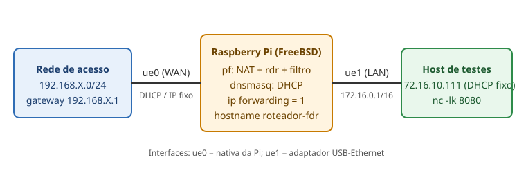
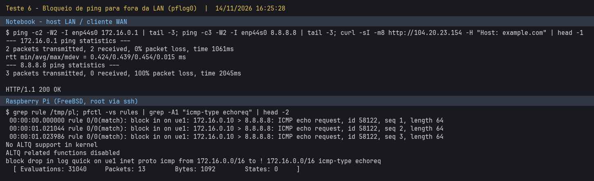

# Trabalho 02 - Camada de Rede: NAT, DHCP e DNAT

**Disciplina:** Fundamentos de Redes de Computadores  
**Professor:** Tiago Alves  
**Repositório:** [github.com/Potatoyz908/FundamentosDeRedes_Trabalho2](https://github.com/Potatoyz908/FundamentosDeRedes_Trabalho2)

Roteador FreeBSD em Raspberry Pi que liga uma rede de acesso (WAN) a uma LAN privada 172.16.0.0/16, com NAT, servidor DHCP com IP reservado, DNAT da porta 80 para a 8080 de um host da LAN, isolamento da WAN e bloqueio de ping para fora da LAN.

## 1. Integrantes

- Davi Camilo Menezes (231011220)
- Euller Júlio da Silva (231026714)
- Giovani de Oliveira Teodoro Coelho (241032500)
- Pedro Henrique Freire Rodrigues (231026545)

## 2. Como o repositório está organizado

```
README.md                  visão geral, implementação, validação e limitações (este arquivo)
configs/                   rc.conf, pf.conf e dnsmasq.conf, os mesmos instalados na Pi
docs/1-arquitetura.md      como cada parte funciona e por quê
docs/2-instalacao.md       do cartão SD ao roteador pronto
docs/3-validacao.md        testes passo a passo, com resultado esperado
docs/4-demonstracao.md     roteiro da demonstração, perguntas prováveis e plano B
docs/5-auditoria.md        resultado da validação de 14/11/2026 e pendências
docs/6-divisao-equipe.md   quem responde por cada parte na demonstração
docs/img/                  diagramas (topologia, NAT/DNAT, DHCP)
evidencias/                saídas reais dos testes (prints/ e auditoria_2026-11-14.txt)
sim/                       simulador web interativo (Pi/LAN/WAN) para ensaiar D0–D7
versoes.txt                versões do sistema e dos serviços
referencias/               enunciado do trabalho
```

**Ensaio sem hardware:** abra [`sim/index.html`](sim/index.html) (ou `python -m http.server` dentro de `sim/`) — ver [`sim/README.md`](sim/README.md). Pronto para GitHub Pages.

## 3. Ambiente e sistema operacional

- **Sistema operacional:** FreeBSD 15.1-RELEASE (arm64, GENERIC) em Raspberry Pi física, sem virtualização e sem distribuição de gateway pronto (versões em `versoes.txt`). O enunciado limita a nota por sistema (\*BSD 100%, Linux 90%, outro 70%).
- **Ambiente de desenvolvimento:** a Pi é acessada por SSH de um notebook Linux; os arquivos são editados no repositório e copiados para a Pi.
- **Linguagem:** arquivos de configuração (`rc.conf` em sintaxe sh, `pf.conf` e `dnsmasq.conf`); sem programação.
- **Compilador:** não se aplica.
- **Editor/IDE:** VS Code

## 4. Aplicações demandadas na implementação da rede LAN

| Aplicação                                           | Função                                                  | Arquivo                |
| --------------------------------------------------- | ------------------------------------------------------- | ---------------------- |
| FreeBSD `rc` (`gateway_enable`)                     | Repasse IPv4 entre WAN e LAN; sobe os serviços no boot  | `configs/rc.conf`      |
| `pf` (Packet Filter)                                | NAT, DNAT (`rdr`), isolamento da WAN e bloqueio de ping | `configs/pf.conf`      |
| `pflog`                                             | Registro dos pacotes bloqueados em `pflog0`             | `configs/rc.conf`      |
| `dnsmasq` 2.93 (só DHCP, `port=0`)                  | DHCP, reserva de IP por MAC e log das leases            | `configs/dnsmasq.conf` |
| `sshd`                                              | Administração remota                                    | `configs/rc.conf`      |
| `netcat`, `telnet`, `tcpdump`, `curl`, `traceroute` | Ferramentas de teste                                    | clientes               |



| Item           | Valor                                                                                                                 |
| -------------- | --------------------------------------------------------------------------------------------------------------------- |
| WAN (`ue0`)    | DHCP da rede de acesso (em casa 192.168.1.31/24); no laboratório IP fixo 192.168.X.Y (linhas comentadas em `rc.conf`) |
| LAN (`ue1`)    | 172.16.0.1/16                                                                                                         |
| Faixa DHCP     | 172.16.1.1 a 172.16.1.254, máscara 255.255.0.0, lease de 12 h                                                         |
| Host de testes | 172.16.0.10 (reserva por MAC, lease infinita)                                                                         |
| DNS entregue   | 164.41.101.4 e 164.41.101.11                                                                                          |
| DNAT           | porta TCP 80 da WAN para 172.16.0.10 porta 8080                                                                       |

## 5. Arquivos de configuração

| Arquivo                | Destino na Pi                 | O que faz                                                                                                                                                                           |
| ---------------------- | ----------------------------- | ----------------------------------------------------------------------------------------------------------------------------------------------------------------------------------- |
| `configs/rc.conf`      | `/etc/rc.conf`                | IP da WAN por DHCP, `172.16.0.1/16` na LAN, `gateway_enable="YES"`, liga `pf`, `pflog`, `dnsmasq` e `sshd`                                                                          |
| `configs/pf.conf`      | `/etc/pf.conf`                | `nat` e `rdr` com `tag`; `block in quick` do ICMP echo request da LAN para fora da LAN; `block in on ue0 all` com exceções (SSH, ping ao roteador, DHCP, tráfego marcado pelo DNAT) |
| `configs/dnsmasq.conf` | `/usr/local/etc/dnsmasq.conf` | Só DHCP na `ue1`: faixa, gateway, DNS, `dhcp-host` (reserva), `dhcp-leasefile` e `log-dhcp`                                                                                         |

A explicação linha a linha está em [docs/1-arquitetura.md](docs/1-arquitetura.md).

## 6. Como implementar a rede LAN

Passo a passo completo em [docs/2-instalacao.md](docs/2-instalacao.md). Resumo, com `ue0` = WAN (nativa da Pi) e `ue1` = LAN (adaptador USB-Ethernet); conferir com `ifconfig` e, se estiverem invertidas, trocar só as macros `wan_if`/`lan_if` (`pf.conf`), `interface=` (`dnsmasq.conf`) e `ifconfig_ue*` (`rc.conf`):

1. Gravar a imagem FreeBSD 15.1 arm64 para Raspberry Pi no microSD, dar boot e acessar por SSH (`ssh freebsd@IP_DA_PI`, depois `su -`).
2. Instalar o DHCP: `pkg install -y dnsmasq`.
3. Copiar os arquivos e **validar antes de aplicar** (arquivo com erro é anulado):
   ```sh
   cp /etc/rc.conf /etc/rc.conf.orig
   cp pf.conf /etc/pf.conf
   cp dnsmasq.conf /usr/local/etc/dnsmasq.conf
   cp rc.conf /etc/rc.conf
   pfctl -nf /etc/pf.conf
   dnsmasq --test -C /usr/local/etc/dnsmasq.conf
   sh -n /etc/rc.conf
   ```
4. Reiniciar (`shutdown -r now`). No boot sobem `pf`, `pflog` e `dnsmasq`. Ligar o `pf` com o SSH aberto pode congelar a sessão; por isso reiniciar.
5. Ligar o host de testes na `ue1` (Wi-Fi desligado), ler o MAC em `/var/db/dnsmasq.leases` e, se for outra máquina, trocar a linha `dhcp-host=` do `dnsmasq.conf` e rodar `service dnsmasq restart`.
6. No laboratório com IP fixo, usar as linhas comentadas do `rc.conf` (`ifconfig_ue0` e `defaultrouter` com 192.168.X.Y e 192.168.X.1).

## 7. Como validar a configuração da rede LAN

Roteiro detalhado, com comandos para Linux e Windows, em [docs/3-validacao.md](docs/3-validacao.md). Abrir dois terminais: um no host e outro com SSH na Pi.

| Teste            | Onde          | Comando                                                                     | Esperado                                    |
| ---------------- | ------------- | --------------------------------------------------------------------------- | ------------------------------------------- |
| Conectividade    | host LAN      | `ping 172.16.0.1`; `curl -I http://unb.br`; `traceroute -n 192.168.2.241`   | responde; primeiro salto 172.16.0.1         |
| NAT              | Pi            | `tcpdump -ni ue1 tcp port 80` e `tcpdump -ni ue0 tcp port 80` + `pfctl -ss` | origem 172.16.0.10 na LAN; IP da WAN na WAN |
| Isolamento       | WAN           | ping e `nc -vz` direto à LAN, com rota forçada via Pi                       | falha; contador do `block ... ue0` sobe     |
| DHCP e IP fixo   | host LAN      | renovar o DHCP várias vezes                                                 | sempre 172.16.0.10                          |
| Leases em log    | Pi            | `cat /var/db/dnsmasq.leases`; `grep DHCP /var/log/dnsmasq.log`              | MAC, IP e mensagens DORA                    |
| DNAT             | LAN e WAN     | `nc -lk 8080` na LAN; `telnet 192.168.2.241 80` na WAN                      | texto atravessa nos dois sentidos           |
| Bloqueio de ping | host LAN / Pi | `ping 172.16.0.1` e `ping 192.168.2.241`; `tcpdump -n -e -i pflog0`         | gateway responde; externo 100% de perda     |

Resultado da validação de 14/11/2026 (todos os requisitos passaram; detalhes em [docs/5-auditoria.md](docs/5-auditoria.md)):

| Imagem                                                                                      | Teste                                          |
| ------------------------------------------------------------------------------------------- | ---------------------------------------------- |
| `evidencias/prints/01_pre_checagem_pi.png`, `02_regras_pf.png`, `03_validacao_arquivos.png` | estado do roteador, regras e arquivos sem erro |
| `evidencias/prints/04_teste1_conectividade.png`                                             | 1 Conectividade                                |
| `evidencias/prints/05_teste2_nat.png`                                                       | 2 NAT                                          |
| `evidencias/prints/09_teste3_isolamento.png`                                                | 3 Isolamento (rota forçada a partir da WAN)    |
| `evidencias/prints/06_teste4_dhcp.png`                                                      | 4 DHCP, IP fixo e leases                       |
| `evidencias/prints/10_teste5_dnat.png`                                                      | 5 DNAT ponta a ponta                           |
| `evidencias/prints/07_teste6_bloqueio_ping.png`                                             | 6 Bloqueio de ping                             |
| `evidencias/prints/08_servico_dnsmasq.png`                                                  | `service dnsmasq stop` e `start`               |




As imagens foram geradas a partir da saída real dos comandos (cada uma acompanha um `.txt` com o mesmo texto).

## 8. Quais são as limitações conhecidas

- Só IPv4; sem IPv6 e sem regras `inet6`.
- O DNAT atende uma única porta (80 para 8080) e um único destino fixo (172.16.0.10).
- NAT de retorno (hairpin) não é tratado: o host da LAN não alcança a si mesmo pelo IP da WAN.
- O host de testes é reconhecido por MAC; outra máquina precisa de nova linha `dhcp-host`.
- Os DNS 164.41.101.4 e 164.41.101.11 só respondem dentro da rede da UnB; fora dela os clientes recebem o endereço, mas a resolução por eles falha.
- O adaptador USB-Ethernet (USB 2.0 compartilhado com a WAN) limita a vazão, e o nome `ue1` depende da ordem de detecção USB.
- O bloqueio de ping vale para ICMP echo request da LAN para fora da LAN; traceroute UDP e TCP continuam passando, de propósito.
- Sem relógio de hardware, a hora da Pi depende do NTP; desligar sem `shutdown` pode corromper o microSD.
- O DNAT só funciona para quem tem a Pi como gateway de volta (o host da LAN, via DHCP).

## 9. Montar o ZIP de entrega

Conteúdo: `README.md`, `configs/`, `docs/`, `evidencias/`, `versoes.txt` e `referencias/`. Validar os arquivos de novo a partir do ZIP antes de enviar.

```sh
# Linux e macOS, na raiz do repositório
zip -r trabalho02.zip README.md configs docs evidencias versoes.txt referencias

# Windows (PowerShell)
Compress-Archive -Path README.md,configs,docs,evidencias,versoes.txt,referencias -DestinationPath trabalho02.zip
```

## 10. Fontes

- Enunciado do Trabalho 02 (`referencias/trabalho_02_v5.pdf`).
- Wright, G. R.; Stevens, W. R. _TCP/IP Illustrated_, v. 2. Addison-Wesley, 1995.
- Lucas, M. W. _Networking for System Administrators_. 2. ed. Tilted Windmill Press, 2025.
- Páginas de manual `pf.conf(5)`, `rc.conf(5)` e `dnsmasq(8)`.
