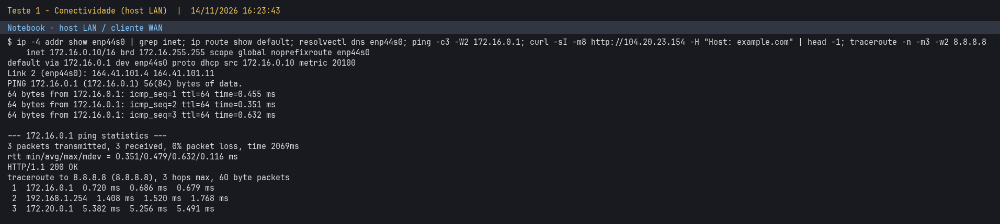
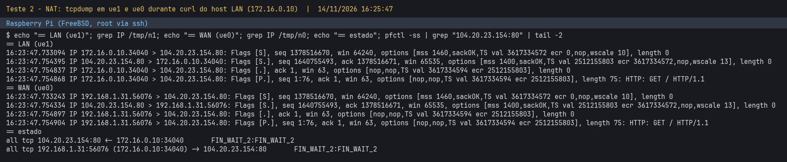
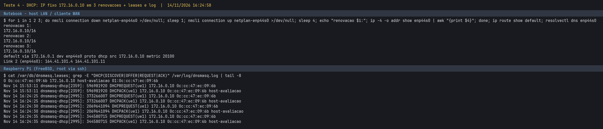
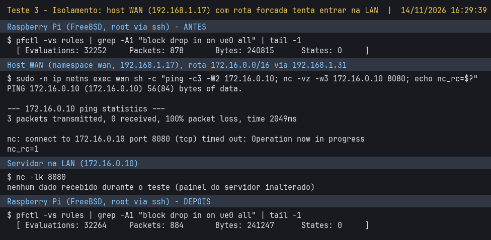
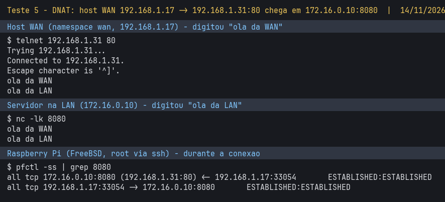

# Trabalho 02 - Fundamentos de Redes de Computadores

**Disciplina:** Fundamentos de Redes de Computadores  
**Professor:** Tiago Alves  

## 1. Integrantes
- Davi Camilo Menezes (231011220)
- Euller Júlio da Silva (231026714)
- Giovani de Oliveira Teodoro Coelho (241032500)
- Pedro Henrique Freire Rodrigues (231026545)

## 2. Ambiente de Desenvolvimento
- **Qual sistema operacional foi usado na construção do sistema:** FreeBSD 15.1-RELEASE (arm64, GENERIC), em Raspberry Pi física, sem virtualização e sem derivações de gateway pronto (versões em `versoes.txt`).
- **Qual ambiente de desenvolvimento foi usado:** a Raspberry Pi acessada por SSH a partir de um notebook Linux; os arquivos de configuração são editados no repositório e copiados para a Pi.
- **Linguagem:** arquivos de configuração (`rc.conf` em sintaxe sh, `pf.conf` e `dnsmasq.conf`); sem programação.
- **Compilador:** não se aplica.
- **Editor/IDE:** VS Code

## 3. Aplicações demandadas na implementação da rede LAN

| Aplicação | Função | Arquivo |
| --- | --- | --- |
| FreeBSD `rc` (`gateway_enable`) | Repasse IPv4 entre WAN e LAN e subida dos serviços no boot | `configs/rc.conf` |
| `pf` (Packet Filter) | NAT, DNAT (`rdr`), isolamento da WAN e bloqueio de ping para fora | `configs/pf.conf` |
| `pflog` | Registro dos pacotes bloqueados (`pflog0`) | `configs/rc.conf` |
| `dnsmasq` 2.93 (só DHCP, `port=0`) | DHCP, reserva de IP por MAC e log das leases | `configs/dnsmasq.conf` |
| `sshd` | Administração remota | `configs/rc.conf` |
| `netcat`, `telnet`, `tcpdump`, `curl`, `traceroute`, `dig` | Ferramentas de teste | (clientes) |

Topologia e endereçamento:

```
 Rede de acesso 192.168.X.0/24 ---- ue0 [ Raspberry Pi / FreeBSD ] ue1 ---- Host LAN 172.16.0.10
        (WAN, DHCP ou fixo)              pf: NAT + rdr + filtro         (172.16.0.1/16)   DHCP, IP reservado
```

| Item | Valor |
| --- | --- |
| WAN (`ue0`) | DHCP da rede de acesso (em casa: 192.168.1.31/24; no laboratório: IP fixo 192.168.X.Y, ver `rc.conf`) |
| LAN (`ue1`) | 172.16.0.1/16 (faixa privada RFC 1918) |
| Faixa DHCP | 172.16.1.1 a 172.16.1.254, máscara 255.255.0.0, lease de 12 h |
| Host de testes | 172.16.0.10 (reserva por MAC, lease infinita) |
| DNS entregue | 164.41.101.4 e 164.41.101.11 |
| DNAT | porta TCP 80 da WAN para 172.16.0.10 porta 8080 |

## 4. Como implementar a rede LAN

Nomes de interface: `ue0` = WAN (nativa da Pi) e `ue1` = LAN (adaptador USB-Ethernet). Confirmar com `ifconfig` antes de copiar os arquivos; se estiverem invertidos, trocar só as macros (`wan_if`/`lan_if` no `pf.conf`, `interface=` no `dnsmasq.conf` e `ifconfig_ue*` no `rc.conf`).

1. Gravar a imagem FreeBSD 15.x arm64 para Raspberry Pi no microSD, dar boot e acessar por SSH.
2. Instalar o DHCP: `pkg install -y dnsmasq`.
3. Copiar os arquivos do repositório:
   ```sh
   cp configs/pf.conf       /etc/pf.conf
   cp configs/dnsmasq.conf  /usr/local/etc/dnsmasq.conf
   # rc.conf: mesclar com o da imagem (diff) e manter as linhas do sistema
   cp configs/rc.conf       /etc/rc.conf
   ```
4. **Antes de aplicar**, validar (arquivo com erro é anulado):
   ```sh
   pfctl -nf /etc/pf.conf
   dnsmasq --test -C /usr/local/etc/dnsmasq.conf
   sh -n /etc/rc.conf
   ```
5. Se o host de testes não for o notebook cadastrado, trocar o MAC na linha `dhcp-host=` do `dnsmasq.conf` (o MAC aparece em `/var/db/dnsmasq.leases` depois de o host pedir um IP) e rodar `service dnsmasq restart`.
6. Reiniciar a Pi (`shutdown -r now`). No boot sobem `pf`, `pflog` e `dnsmasq`. Ligar o `pf` com a sessão SSH aberta pode congelá-la; por isso reiniciar.
7. No laboratório com IP fixo, usar as linhas alternativas comentadas de `rc.conf` (`ifconfig_ue0` e `defaultrouter` com 192.168.X.Y e 192.168.X.1) e, se o professor pedir, trocar o DNS por 192.168.X.1 no `dnsmasq.conf`.

Resumo do que cada arquivo faz:
- `rc.conf`: IP da WAN por DHCP, `172.16.0.1/16` na LAN, `gateway_enable="YES"` (encaminhamento), liga `pf`, `pflog`, `dnsmasq`, `sshd`.
- `pf.conf`: `nat ... -> (ue0)` (acompanha o IP atual da WAN); `rdr` da 80 para 172.16.0.10:8080 com `tag`; `block in quick` do ICMP echo request da LAN para fora da LAN; `block in on ue0 all` com exceções (SSH, ping ao roteador, DHCP, tráfego marcado pelo DNAT).
- `dnsmasq.conf`: só DHCP na `ue1`, faixa, gateway, DNS, `dhcp-host` (reserva), `dhcp-leasefile` e `log-dhcp`.

## 5. Como validar a configuração da rede LAN

O passo a passo completo, com comandos, resultado esperado e o que cada teste prova, está em **`docs/testes.md`**. As saídas reais obtidas na auditoria de 14/11/2026 estão em `evidencias/auditoria_2026-11-14.txt`. Resumo:

| Teste | Onde | Comando | Esperado |
| --- | --- | --- | --- |
| Conectividade | host LAN | `ping 172.16.0.1`; `curl -I https://www.freebsd.org`; `traceroute -n 8.8.8.8` | responde; 1º salto 172.16.0.1 |
| NAT | Pi | `tcpdump -ni ue1` e `tcpdump -ni ue0` + `pfctl -ss` | origem 172.16.0.10 na LAN; IP da WAN na WAN |
| Isolamento | WAN | ping/TCP direto à LAN (rota forçada) | falha; contador do `block ... ue0` sobe |
| DHCP e IP fixo | host LAN / Pi | renovar o DHCP várias vezes | sempre 172.16.0.10 |
| Leases em log | Pi | `cat /var/db/dnsmasq.leases`; `grep DHCP /var/log/dnsmasq.log` | MAC, IP e etapas DORA |
| DNAT | LAN e WAN | `nc -lk 8080` na LAN; `telnet IP_WAN 80` na WAN | texto atravessa |
| Bloqueio de ping | host LAN / Pi | `ping 172.16.0.1` e `ping 8.8.8.8`; `tcpdump -n -e -i pflog0` | gateway responde; externo 100% de perda |

Prints dos testes (gerados a partir da execução real na Pi e no notebook, em 14/11/2026):

| Teste | Imagem |
| --- | --- |
| Pré-checagem do roteador | `evidencias/prints/01_pre_checagem_pi.png` |
| Regras NAT/DNAT/filtro | `evidencias/prints/02_regras_pf.png` |
| Validação dos arquivos | `evidencias/prints/03_validacao_arquivos.png` |
| 1 Conectividade | `evidencias/prints/04_teste1_conectividade.png` |
| 2 NAT | `evidencias/prints/05_teste2_nat.png` |
| 3 Isolamento (rota forçada a partir da WAN) | `evidencias/prints/09_teste3_isolamento.png` |
| 4 DHCP, IP fixo e leases | `evidencias/prints/06_teste4_dhcp.png` |
| 5 DNAT 80 para 8080 (ponta a ponta) | `evidencias/prints/10_teste5_dnat.png` |
| 6 Bloqueio de ping | `evidencias/prints/07_teste6_bloqueio_ping.png` |
| Serviço dnsmasq (stop/start) | `evidencias/prints/08_servico_dnsmasq.png` |








## 6. Quais são as limitações conhecidas

- Só IPv4; sem IPv6 e sem regras `inet6`.
- O DNAT atende uma única porta (80 para 8080) e um único destino fixo (172.16.0.10).
- NAT de retorno (hairpin) não é tratado: o host da LAN não alcança a si mesmo pelo IP da WAN.
- O host de testes é reconhecido por MAC; outra máquina precisa de nova linha `dhcp-host` (a doc indica onde ler o MAC).
- Os DNS 164.41.101.4 e 164.41.101.11 só respondem dentro da rede da UnB; fora dela os clientes recebem o endereço, mas a resolução por eles falha.
- Adaptador USB-Ethernet (USB 2.0 compartilhado com a WAN) limita a vazão; o nome `ue1` depende da ordem de detecção USB.
- O bloqueio de ping vale para ICMP echo request da LAN para fora da LAN; traceroute UDP e TCP continuam passando, de propósito.
- Sem relógio de hardware na Pi, a hora depende do NTP; desligar sem `shutdown` pode corromper o microSD.
- O DNAT só é testável a partir de um equipamento do lado WAN cuja resposta volte pela Pi (o host da LAN precisa ter a Pi como gateway).

## 7. Estrutura do repositório

```
README.md        documentação principal (este arquivo)
configs/         rc.conf, pf.conf, dnsmasq.conf (os mesmos instalados na Pi)
docs/            testes.md (roteiro de validação), AUDITORIA.md, PLANO.md, roteiro do ensaio
evidencias/      saídas reais dos testes
versoes.txt      versões do sistema e dos serviços
referencias/     enunciado do trabalho
```
