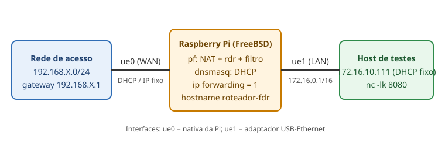
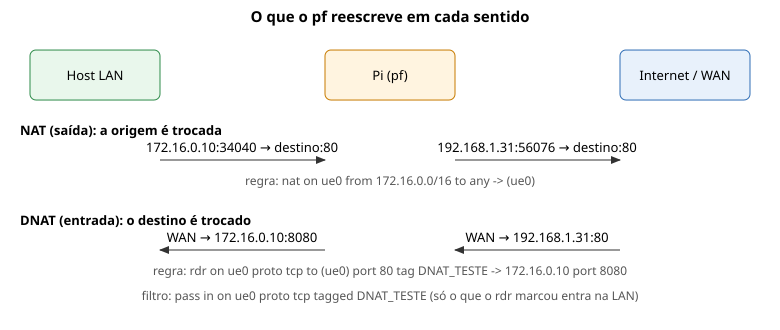
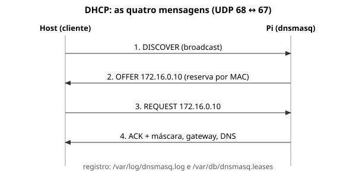

# Arquitetura: como o roteador funciona

Este documento explica o que cada parte da configuração faz e por quê. Serve de apoio para responder perguntas durante a demonstração.



## 1. Endereçamento

| Item | Valor | Motivo |
| --- | --- | --- |
| WAN (`ue0`) | IP da rede de acesso 192.168.X.0/24, por DHCP (ou fixo no laboratório) | Enunciado: a WAN assume um IP da rede de acesso |
| LAN (`ue1`) | 172.16.0.1/16 | Bloco privado (RFC 1918) com máscara /16, como pedido; não colide com 192.168.X.0/24 |
| Faixa DHCP | 172.16.1.1 a 172.16.1.254 | Fica fora de 172.16.0.x, onde ficam o gateway e o host fixo |
| Host de testes | 172.16.10.111 | Reserva por MAC; é o destino do DNAT |
| DNS entregue | 164.41.101.4 e 164.41.101.11 | Servidores informados pelo professor |

## 2. Repasse de pacotes

Com duas interfaces, a Pi só encaminha pacotes de uma para a outra se o kernel estiver com `net.inet.ip.forwarding=1`. No FreeBSD isso é feito por `gateway_enable="YES"` no `rc.conf`, que aplica o sysctl no boot.

## 3. NAT (`nat on`)

```
nat on ue0 inet from 172.16.0.0/16 to any -> (ue0)
```

Quando um host da LAN fala com o mundo, o `pf` troca o IP de origem (172.16.10.111) pelo IP da WAN e escolhe outra porta de origem. A tabela de estados guarda a correspondência e usa para desfazer a troca na resposta. Os parênteses em `(ue0)` fazem o `pf` reler o IP da interface: se o DHCP da WAN mudar, a regra continua válida.



## 4. DNAT (`rdr`)

```
rdr on ue0 inet proto tcp from any to (ue0) port 80 tag DNAT_TESTE -> 172.16.10.111 port 8080
```

É o caminho inverso: quem chega na porta 80 da WAN tem o **destino** trocado para 172.16.10.111 porta 8080. A tradução acontece antes do filtro. Por isso o filtro vê o destino já traduzido, e a regra de passagem usa a marca `tagged DNAT_TESTE`, que só existe em pacotes que o `rdr` redirecionou. Assim, nenhum outro tráfego direto para a LAN passa pela WAN.

O host da LAN precisa ter a Pi como gateway para que a resposta volte pelo mesmo caminho (o DHCP já entrega isso).

## 5. Filtro (`pass` e `block`)

No `pf`, vale a **última regra que casa**, exceto quando a regra é `quick` (vale a primeira). Nossa ordem:

| Regra | Função |
| --- | --- |
| `block in quick log on ue1 ... icmp-type echoreq` (origem LAN, destino fora da LAN) | Requisito: ping não sai da LAN. `quick` garante que vale mesmo com os `pass` abaixo; `log` envia cópia para `pflog0` |
| `pass in/out on ue1 all keep state` | O resto da LAN passa |
| `block in on ue0 all` | Política da WAN: nada entra |
| `pass in on ue0 ... port 22` | Exceção: SSH para administrar a Pi |
| `pass in on ue0 ... icmp echoreq` ao IP da Pi | Exceção: ping ao roteador (diagnóstico) |
| `pass in on ue0 ... udp 67 -> 68` | Exceção: resposta DHCP da rede de acesso |
| `pass in on ue0 ... tagged DNAT_TESTE` | Exceção: o que o DNAT redirecionou |
| `pass out on ue0 all keep state` | Saída pela WAN liberada |

NAT não é firewall: o isolamento vem do `block in on ue0 all`. Sem ele, um host da WAN com rota para 172.16.0.0/16 via Pi alcançaria a LAN.

## 6. DHCP (`dnsmasq`)



- `port=0` desliga a parte de DNS do dnsmasq; ele atua só como servidor DHCP, e o DNS vem das opções entregues.
- `interface=ue1` e `bind-interfaces`: só atende a LAN.
- `dhcp-range=172.16.1.1,172.16.1.254,255.255.0.0,12h`: faixa dinâmica, lease de 12 horas.
- `dhcp-option=option:router,172.16.0.1` e `option:dns-server,164.41.101.4,164.41.101.11`: gateway e DNS.
- `dhcp-host=MAC,host-avaliacao,172.16.10.111,infinite`: o host de testes sempre recebe 172.16.10.111.
- `dhcp-leasefile` e `log-dhcp` com `log-facility`: registram as concessões e as mensagens do DORA.

## 7. Arquivos e responsabilidades

| Arquivo | Onde fica na Pi | Responsável por |
| --- | --- | --- |
| `configs/rc.conf` | `/etc/rc.conf` | IPs das interfaces, forwarding, subida dos serviços no boot |
| `configs/pf.conf` | `/etc/pf.conf` | NAT, DNAT, filtro e bloqueio de ping |
| `configs/dnsmasq.conf` | `/usr/local/etc/dnsmasq.conf` | DHCP, reserva de IP e logs |

## 8. Por que FreeBSD

O enunciado limita a nota por sistema: \*BSD vale 100%, Linux 90%. O FreeBSD traz `pf` e `pflog` integrados e o `dnsmasq` instala por pacote, sem usar distribuição de "gateway pronto", que o enunciado não aceita.
